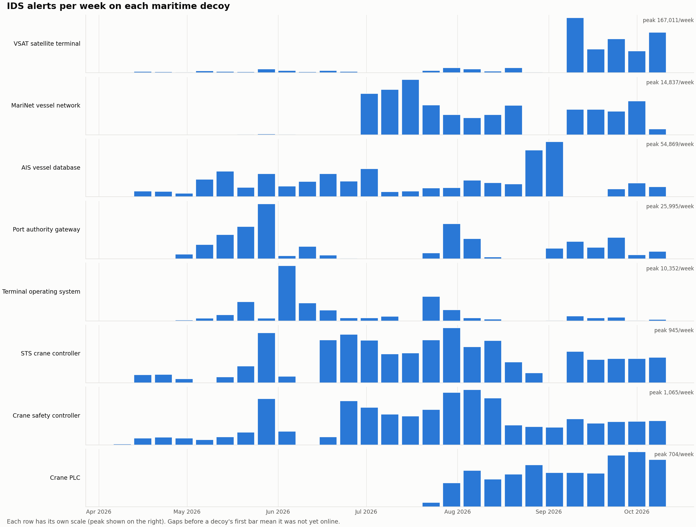

# Activity Overview

## When it happened

Click to enlarge. One row per decoy, each on its own scale; the weekly peak is shown on the right.

How to read it:

- **No decoy was ever quiet.** Every decoy received alerts in almost every week it was online.
- **The satellite terminal surged in September.** Alerts jumped to **167,011 in the week of 7 September**, far above anything before, and stayed high for the rest of the period. Almost all of it came from blocklisted mass scanners (see [Attack Breakdown](./attack-breakdown.md)).
- **The port gateway and terminal operating system came in waves**, peaking in late May and early June. Bursts like these usually mean a scanning campaign working through an address range.
- **The crane controllers show a steady drumbeat** of a few hundred to about 1,000 Modbus alerts a week. The newest one (*Crane PLC*, first alert 24 July) climbed steadily as it was discovered.

## Where it came from

Event counts by country are dominated by a few very busy senders. So instead, the table below counts **how many of the most active sources** are registered in each country: the 4,719 IPs that sent at least 1,000 events or reached three or more decoys.

| Country (registry) | Active sources |
|---|---:|
| United States | 2,446 |
| United Kingdom | 687 |
| Bulgaria | 319 |
| Netherlands | 186 |
| France | 176 |
| Germany | 134 |
| China | 91 |
| Portugal | 86 |
| Seychelles | 70 |
| Russia | 55 |

The **networks** behind these sources tell more than the countries do:

- **Cloud and hosting providers** host a large share: Google (587 IPs), Akamai/Linode (300), DigitalOcean (160) and Microsoft (158). Renting a server is cheap, and many attackers' machines are other people's compromised servers.
- **Internet survey services** are well represented: Censys (378 IPs), ONYPHE (148) and Driftnet (143) scan the whole internet and publish what they find. Their scans aren't attacks, but they make an exposed crane or AIS server findable by anyone who searches those services.
- **A few networks send huge volumes.** TechTies (274 IPs, 1.9 million events), Pfcloud (1.0 million events from a single IP) and Amarutu Technology (0.8 million).

## A few loud, many quiet

Traffic is extremely uneven:

- The **top 1%** of source IPs (1,122 addresses) sent **76% of all events**.
- **40,563 IPs** (36%) sent five events or fewer: a single probe, and they never came back.
- The **ten busiest IPs** sent 26% of all events but only **1.3% of the alerts**. Volume and danger are different things.

| Source IP | Country | Network | Events | Alerts | Decoys reached |
|---|---|---|---:|---:|---:|
| 204.76.203.18 | NL | Pfcloud UG | 1,004,587 | 6,239 | 2 |
| 80.251.153.178 | SC | Amarutu Technology | 769,341 | 2,663 | 1 |
| 39.101.69.5 | CN | Alibaba (Hangzhou) | 230,686 | 1,488 | 2 |
| 37.111.53.110 | MM | Atom Myanmar | 166,051 | 1,865 | 4 |
| 51.68.46.72 | FR | OVH | 152,302 | 61 | 1 |
| 43.248.172.18 | SG | BGPNET | 141,101 | 9 | 1 |
| 101.201.31.157 | CN | Alibaba (Hangzhou) | 117,180 | 630 | 1 |
| 159.65.197.211 | US | DigitalOcean | 114,240 | 0 | 1 |
| 95.40.160.2 | US | Amazon | 112,021 | 14 | 1 |
| 62.60.130.193 | IR | Cipher Operations | 109,778 | 2,952 | 2 |

Country and network come from IP registry data. The full list of 4,719 active sources is in [Indicators & Detection](./indicators.md#source-ips).
