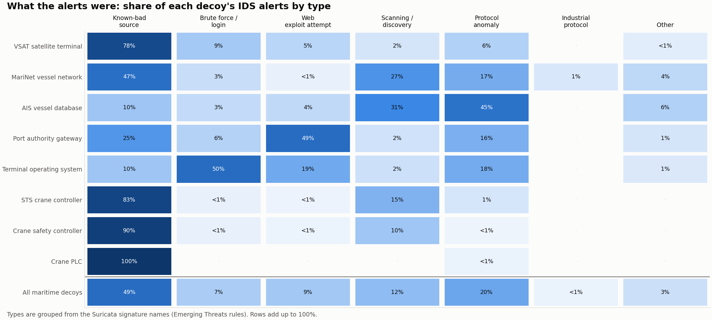
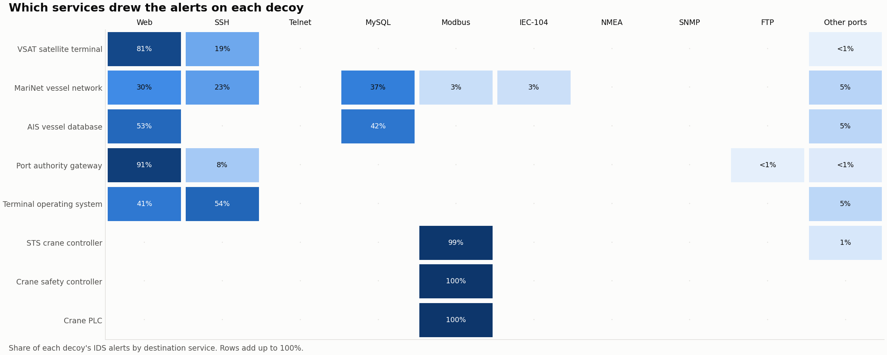

# Attack Breakdown

## What the alerts were

Click to enlarge. Each row adds up to 100%. Types are defined in <a href="./data-and-method.html#how-alerts-were-grouped">Data &amp; Method</a>.

Across all eight decoys:

| Type | Share of alerts | In plain words |
|---|---:|---|
| Known-bad source | 49% | Senders already on public blocklists |
| Protocol anomaly | 20% | Malformed traffic, typical of scanning tools |
| Scanning / discovery | 12% | Probing which services exist |
| Web exploit attempt | 9% | Trying known web vulnerabilities |
| Brute force / login | 7% | Guessing passwords |
| Industrial protocol | <1% | Speaking Modbus or IEC-104 in a way a rule recognises |

## Which services were targeted

Click to enlarge. Each decoy's alerts by destination service; each row adds up to 100%.

Every decoy was attacked through **what it exposes**. The VSAT terminal and port gateway were hit through their web interfaces, the vessel network and AIS database through MySQL, the terminal operating system through SSH, and the cranes through Modbus.

## The five things attackers did

### 1. Arrived from known-bad addresses

**649,977 alerts (49%)** fired only because the sender was on a public blocklist: Spamhaus DROP (471,964), CINS (97,438) and DShield (65,581). For the crane controllers, blocklisted senders were **83–100%** of everything that reached the Modbus port. The satellite terminal, including its September surge, was the same story: 78% of its alerts came from blocklisted networks.

### 2. Scanned for databases and remote desktops

- **124,683** probes of MySQL (TCP 3306) on the AIS database and vessel network, plus **8,146** bursts of failed MySQL logins.
- **31,394** Windows Remote Desktop (RDP) handshakes sent to ports that don't run RDP, **including the Modbus port of the crane controllers**. Scanners don't check what a port is for; they try everything everywhere.
- Internet-wide scanning tools identified themselves: Zmap (4,842 alerts) and LeakIX (3,325).

### 3. Guessed passwords

- SSH brute forcing, mostly from automated tools: **68,479 alerts** for the `SSH-2.0-Go` client banner, which is used by Go-based password-guessing bots.
- Half of all alerts on the **terminal operating system** were SSH login attempts. Running SSH on non-standard ports (2222 and 2223 on the satellite terminal and vessel network) did not hide it: those ports drew 141,000 alerts.

### 4. Tried web exploits

- **Log4Shell** ([CVE-2021-44228](https://nvd.nist.gov/vuln/detail/CVE-2021-44228)), from 2021, is still the most attempted exploit: **28,980** attempts, almost all against the **port authority gateway**.
- **Secret hunting:** 34,570 requests for `.env` files, which on a real server often hold database passwords and API keys.
- **React2Shell** ([CVE-2025-55182](https://nvd.nist.gov/vuln/detail/CVE-2025-55182)), a 2025 remote-code-execution bug in React Server Components: **3,364** attempts across five decoys.
- **The Redtail cryptomining botnet**, covered in [our Redtail report](../redtail-doc/README.md), sent **73,988** requests to the satellite terminal and port gateway. It is also the most common malware family among matched source IPs (see [Campaign Analysis](./campaign-analysis.md)).

### 5. Spoke industrial protocols

- **Modbus.** Every alert on the three crane controllers (**28,036**) was on Modbus port 502, and the vessel network drew another 2,742. Most came from blocklisted scanners mapping which addresses answer on Modbus. That is how exposed PLCs end up in search engines and target lists.
- **IEC-104.** On the vessel network, Suricata recorded complete IEC-104 conversations: **196 sessions opened** (STARTDT), test frames, and **180 general interrogation commands**. In a real system that command makes the controller report every value it holds. It is not an attack by itself, but it is exactly the reconnaissance that comes before one.

## Does the decoy type matter?

Yes, but in a specific way. **Attackers use whatever a system exposes, not what it is called.** No signature showed an attacker who knew it was talking to a ship or a port. The maritime context only matters once someone reaches the industrial layer. On a real crane or vessel network, that Modbus or IEC-104 access would be a direct path to physical equipment.
