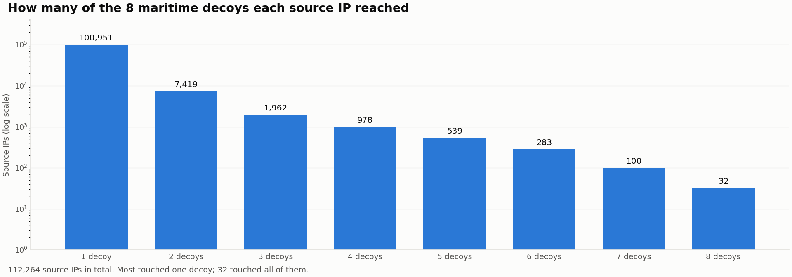
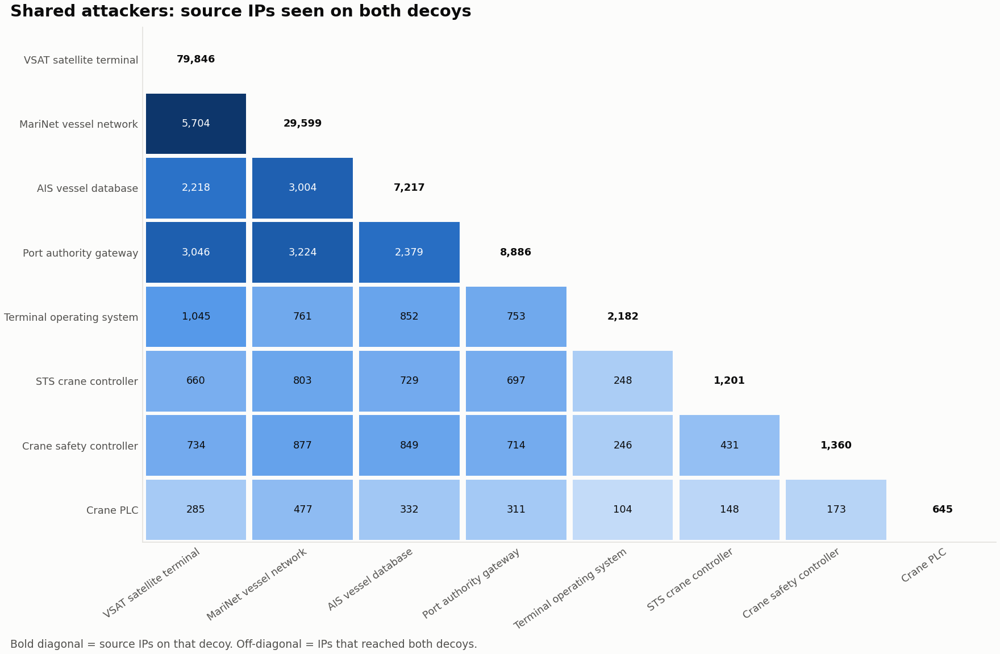

# Campaign Analysis

## How far each attacker reached

Click to enlarge. Note the log scale: each bar is roughly a third the height of the one before.

| Decoys reached | Source IPs |
|---|---:|
| 1 | 100,951 |
| 2 | 7,419 |
| 3 | 1,962 |
| 4 | 978 |
| 5 | 539 |
| 6 | 283 |
| 7 | 100 |
| All 8 | 32 |

**90%** of attackers touched a single decoy, which is the signature of random, internet-wide scanning. At the other end, **32 IPs reached all eight decoys**. 23 of those 32 belong to **Amazon Web Services**, and the rest to other hosting and internet-survey networks. These are systematic mapping operations that sweep entire address ranges and every port.

## Which decoys share attackers

Click to enlarge. The bold diagonal is the source IPs per decoy. Off-diagonal cells count IPs that reached both decoys.

- **The satellite terminal and vessel network share the most attackers (5,704).** Both expose SSH on ports 2222 and 2223 and a web interface, so the same SSH and web bots find both.
- **The three crane controllers share relatively few attackers with each other** (148–431), but each shares 100–880 with the IT-facing decoys. The scanners that reach Modbus are general-purpose scanners, not crane specialists.

## Known malware infrastructure

**74 source IPs** matched an exact entry in malware threat-intelligence feeds:

| Malware family | Matched IPs | What it is |
|---|---:|---|
| RedTail | 18 | Cryptomining botnet ([our report](../redtail-doc/README.md)) |
| UPSTYLE | 10 | Backdoor used against firewall appliances |
| Mirai | 4 | IoT botnet |
| Sliver | 4 | Attack framework, command-and-control |
| Cobalt Strike | 3 | Attack framework, command-and-control |
| Brute Ratel C4 | 3 | Attack framework, command-and-control |
| Others | 32 | Including PlugX, Remcos, RedLine Stealer, QakBot, XWorm |

Hosting addresses change hands often, so these matches are leads for investigation, not proof of who was behind a connection.

## What it means

The maritime decoys were found by the same global scanning machinery that finds everything else on the internet. That is the main risk: **a crane PLC or AIS server doesn't need to be targeted to be compromised, only exposed**. Survey services such as Censys and ONYPHE index what they find, and blocklisted scanners then reach the industrial ports. On real equipment, the IEC-104 interrogation seen on the vessel network is the step right before an attacker starts sending commands.
