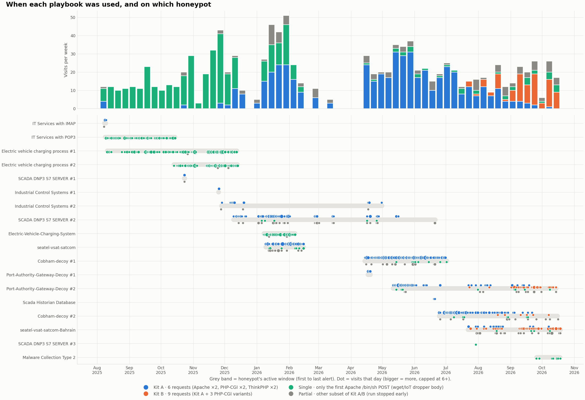

# Activity Overview

## When it happened

Redtail never stopped. Every honeypot that was online received it, from the first week of the dataset to the last.

Top: visits per week, coloured by playbook. Bottom: one row per honeypot. The grey band is when it saw Redtail, and each dot is the visits on one day.

How to read it:

- **Aug – Dec 2025 is green.** The early honeypots (EV charging, POP3) only ever received the single first request. [Campaign Analysis](./campaign-analysis.md) shows this depends on the honeypot, not the date.
- **Jan 2026 onwards is blue.** Industrial, maritime and transport decoys received the full 6-request Kit A.
- **Jul 2026 onwards turns orange.** Kit B, the 9-request update, appears on 23 July and becomes the main version by September.
- **The March 2026 dip** is partly sensor coverage: only two honeypots were online between mid-February and mid-April.

| Month | Visits | | Month | Visits |
|---|---:|---|---|---:|
| Aug 2025 | 45 | | Mar 2026 | 6 |
| Sep 2025 | 61 | | Apr 2026 | 58 |
| Oct 2025 | 62 | | May 2026 | 136 |
| Nov 2025 | 116 | | Jun 2026 | 88 |
| Dec 2025 | 59 | | Jul 2026 | 75 |
| Jan 2026 | 163 | | Aug 2026 | 65 |
| Feb 2026 | 56 | | Sep 2026 | 88 |
| | | | Oct 2026 (to 18th) | 44 |

## Where it came from

The 762 source IPs are spread across the world, with a bias toward countries that host a lot of cloud and VPS servers.

| Country | IPs | Share |
|---|---:|---:|
| United States | 157 | 20.6% |
| China | 88 | 11.5% |
| Germany | 70 | 9.2% |
| United Kingdom | 48 | 6.3% |
| Russia | 30 | 3.9% |
| Hong Kong | 29 | 3.8% |
| Canada | 26 | 3.4% |
| Iran | 25 | 3.3% |
| Singapore | 22 | 2.9% |
| India | 20 | 2.6% |

The networks that send the most are mostly **hosting providers**: Contabo (30 IPs), DigitalOcean (20), ColoCrossing (13), Cogent (13), OVH (9). That fits how Redtail spreads. A server it infects becomes the next sender, so many of these "attackers" are probably compromised servers rather than machines the operator owns.

## Repeat visitors vs one-time visitors

**586 of the 762 IPs (77%) appeared in just one visit.** A small group kept coming back:

| Source IP | Country | Network | Visits | Honeypots | First seen | Last seen |
|---|---|---|---:|---:|---|---|
| 31.132.90.3 | KZ | Kar-Tel LLC | 18 | 4 | 2026-06-11 | 2026-09-21 |
| 101.36.104.242 | CN | — | 15 | 8 | 2025-11-17 | 2026-09-02 |
| 103.40.61.98 | IN | Gleam Worldwide Services | 13 | 7 | 2025-11-28 | 2026-04-19 |
| 110.35.80.116 | ID | PT. NAP Info Lintas Nusa | 13 | 5 | 2026-04-19 | 2026-08-21 |
| 101.47.8.187 | CN | Beijing Dian-Xin-Tong Network | 12 | 4 | 2026-05-12 | 2026-08-22 |
| 185.38.148.2 | GB | Hydra Communications | 11 | 3 | 2026-04-16 | 2026-06-11 |
| 38.211.193.130 | US | Cogent Communications | 8 | 3 | 2025-08-09 | 2025-09-20 |
| 45.43.37.254 | TW | UCloud (HK) Holdings | 7 | 6 | 2026-01-21 | 2026-10-15 |
| 115.248.8.65 | IN | Reliance Communications | 7 | 5 | 2025-10-05 | 2026-07-31 |
| 101.36.107.228 | CN | — | 7 | 4 | 2025-10-29 | 2026-02-02 |

101.36.104.242 is the widest-reaching: it attacked **8 different honeypots** over ten months. The full list of 762 IPs can be downloaded from [Indicators & Detection](./indicators.md#source-ips).
