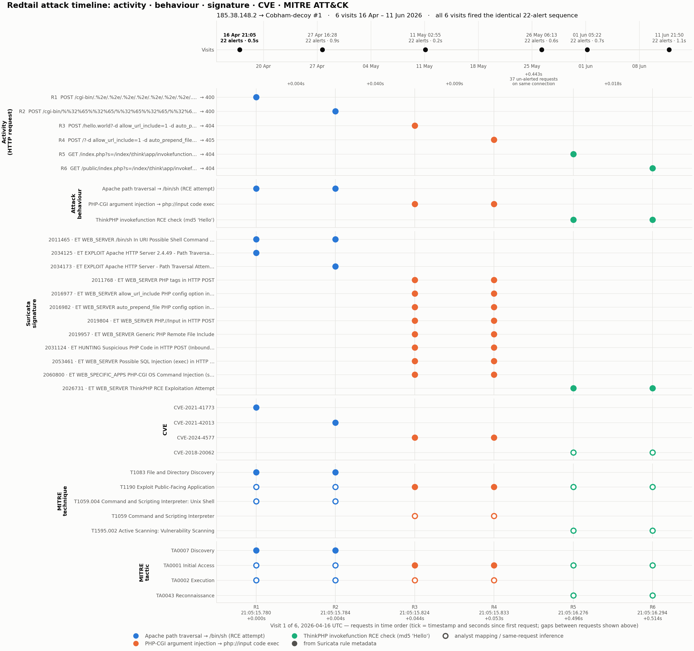
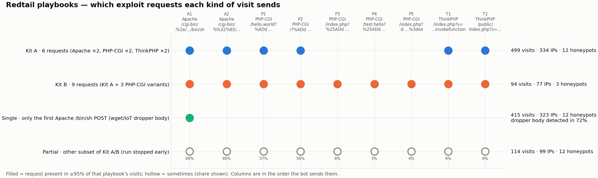
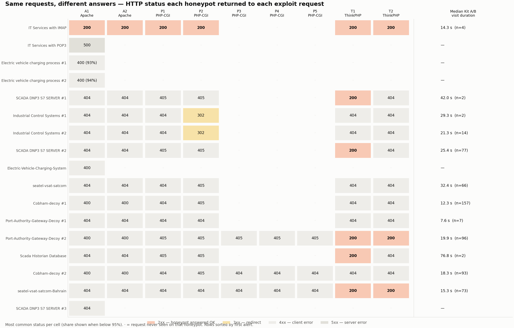

# Attack Breakdown

## What one visit looks like

This is a complete Kit A visit. All six requests are sent in this order, usually within a few seconds:

```http
POST /cgi-bin/.%2e/.%2e/.%2e/.%2e/.%2e/.%2e/.%2e/.%2e/.%2e/.%2e/bin/sh
POST /cgi-bin/%%32%65%%32%65/%%32%65%%32%65/%%32%65%%32%65/%%32%65%%32%65/%%32%65%%32%65/%%32%65%%32%65/%%32%65%%32%65/bin/sh
POST /hello.world?%ADd+allow_url_include%3d1+%ADd+auto_prepend_file%3dphp://input
POST /?%ADd+allow_url_include%3d1+%ADd+auto_prepend_file%3dphp://input
GET  /index.php?s=/index/\think\app/invokefunction&function=call_user_func_array&vars[0]=md5&vars[1][]=Hello
GET  /public/index.php?s=/index/\think\app/invokefunction&function=call_user_func_array&vars[0]=md5&vars[1][]=Hello
User-Agent: libredtail-http
```

It is **three exploits, each tried twice**:

| Requests | Target | Vulnerability | What it tries to do |
|---|---|---|---|
| 1 – 2 | Apache HTTP Server 2.4.49 / 2.4.50 | [CVE-2021-41773](https://nvd.nist.gov/vuln/detail/CVE-2021-41773), [CVE-2021-42013](https://nvd.nist.gov/vuln/detail/CVE-2021-42013) | Escape `/cgi-bin/` with encoded `../` and run `/bin/sh`. Request 2 uses double encoding to get past the first fix. |
| 3 – 4 | PHP-CGI (Windows) | [CVE-2024-4577](https://nvd.nist.gov/vuln/detail/CVE-2024-4577) | A soft hyphen (`%AD`) is read as `-`, turning the URL into PHP command-line options that make PHP **run the POST body as code** |
| 5 – 6 | ThinkPHP 5.x | CVE-2018-20062 (analyst mapping) | Call `md5("Hello")` through the framework. Harmless by itself, it only **checks whether the target is vulnerable** |

The first request often carries a **downloader in its body**: Suricata matched "wget in POST" or "IoT downloader" content in 72% of the single-request visits. That is the step that would fetch and start the miner on a vulnerable server.

## The anatomy of one visit

The chart below takes one real visit (185.38.148.2 on Cobham-decoy #1, 16 Apr 2026) and lines up each request with the alerts, CVEs and MITRE ATT&CK techniques it produced. The whole visit took **0.5 seconds**.


<p class="figure-caption">Click to enlarge. Filled dots come from Suricata rule metadata. Hollow dots are analyst mappings. Between requests 4 and 5 the bot sent 37 more requests on the same connection that matched no rule.</p>

## The four playbooks

Not every visit is a full Kit A. Grouping the 1,122 visits by the requests they contain gives four playbooks:


<p class="figure-caption">Click to enlarge. One row per playbook and one column per exploit request, in the order the bot sends them.</p>

| Playbook | What is sent | Visits | IPs |
|---|---|---:|---:|
| **Kit A** | The 6 requests above | 499 | 334 |
| **Kit B** | Kit A plus 3 more PHP-CGI URL variants (`/index.php?%25ADd…`, `/test.hello?%25ADd…`, `/index.php?-d…`). First seen 23 Jul 2026. | 94 | 77 |
| **Single** | Only request 1, the Apache `/bin/sh` POST, usually with a downloader body | 415 | 323 |
| **Partial** | Kit A or Kit B stopped early (for example only requests 1 – 4) | 114 | 99 |

## Does the bot react to the answers?

No. Each honeypot answers differently: some return `404`, some `405`, and three answered the ThinkPHP check with **`200 OK`**. The bot sends the same requests regardless.


<p class="figure-caption">Most common response per honeypot per request. Orange cells are honeypots that answered "OK".</p>

- **"Success" changes nothing.** After a `200 OK` there is no extra request, no follow-up payload and no change of pace. A human attacker, or a smarter bot, would have pounced.
- **Timing depends on the honeypot.** A full kit took a median of 12 seconds on Cobham-decoy #1 and 32 seconds on seatel-vsat-satcom. Almost all of that is the gap before the ThinkPHP step, where the bot sends its unalerted extra requests.
- **One puzzle remains.** The EV-charging decoys answered request 1 with `400` and the bot stopped. Cobham-decoy also answered `400` and the bot carried on. The status code alone doesn't explain when the bot gives up; see [Campaign Analysis](./campaign-analysis.md).
