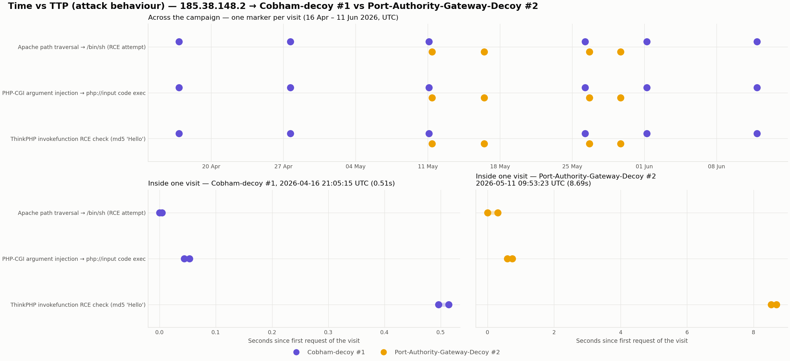
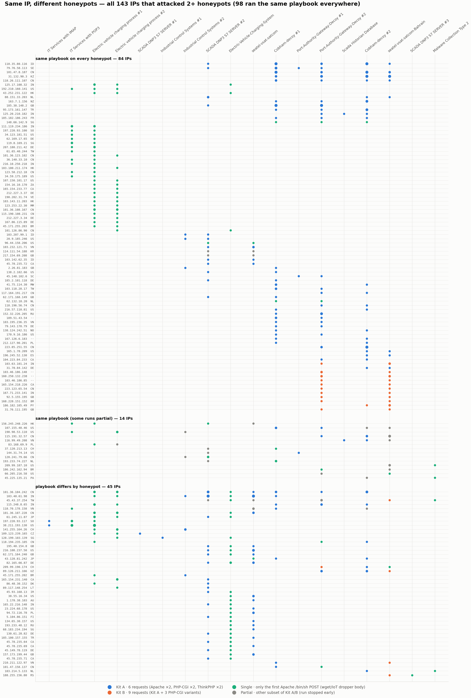
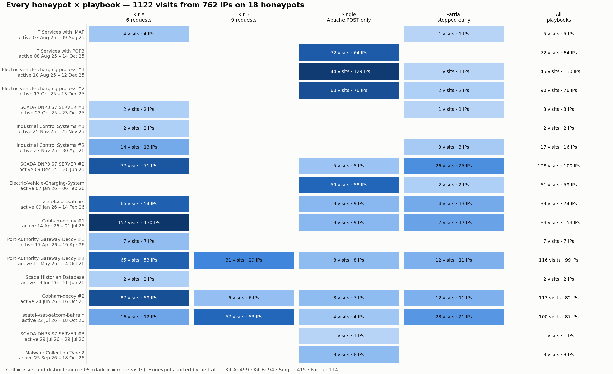
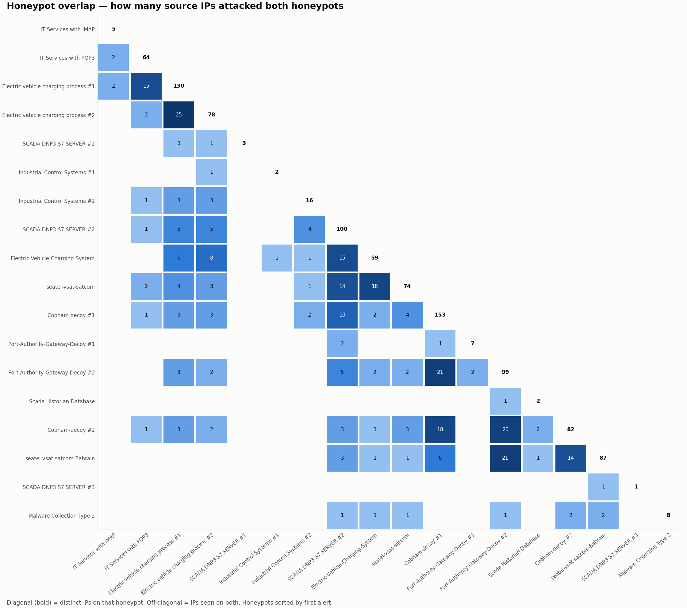

# Campaign Analysis

## One IP, two honeypots

**185.38.148.2** (Hydra Communications, GB) is a good example. Between April and June 2026 it visited three of our honeypots 11 times:

| Honeypot | Visits | Playbook | Responses it got (requests 1 → 6) | Visit length |
|---|---:|---|---|---|
| Cobham-decoy #1 | 6 | Kit A every time | `400 400 404 405 404 404` | 0.2 – 1.1 s |
| Port-Authority-Gateway-Decoy #2 | 4 | Kit A every time | `400 400 405 405 200 200` | 6 – 9 s |
| SCADA DNP3 S7 SERVER #2 | 1 | Kit A | `404 404 405 405 200 404` | — |

Top: each visit by date, one colour per honeypot. Bottom: inside one visit on each honeypot. The order of steps is identical; only the timing differs.

Same requests, same order, same alerts, on every visit and every honeypot. On 11 May and 26 May it hit both Cobham-decoy #1 and Port-Authority-Gateway-Decoy #2 within the same day, which is what you'd expect from a bot working through a target list.

## All IPs that attacked more than one honeypot

**143 IPs** attacked two or more honeypots:

| Behaviour across honeypots | IPs |
|---|---:|
| Same playbook on every honeypot | 84 |
| Same playbook, some runs stopped early | 14 |
| **Playbook differs by honeypot** | **45** |

One row per IP and one column per honeypot (in order of first activity). The dot colour is the playbook that IP used on that honeypot. Click to enlarge.

## Why does the playbook change by honeypot?

Of the 45 IPs whose behaviour differed, **39 show the same pattern**. They sent the full Kit A to industrial or maritime decoys but **only the first request** to the EV-charging, POP3 or malware-collection decoys.

This isn't explained by timing. For example, 101.36.104.242 sent a Single to *Electric vehicle charging process #1* on 6 Dec 2025 and a full Kit A to *SCADA DNP3 S7 SERVER #2* a week later. **31 IPs** did the same within 14 days.

It isn't explained by the response code either, because Cobham-decoy also answered request 1 with `400` and the bot carried on. The likeliest explanation is something about how those honeypots handle the connection after the first request (for example, closing it), which the alert data cannot show. This is worth checking with a packet capture.

Each cell shows visits and distinct IPs. Note the EV-charging and IT-service rows: only Single and Partial, never a full kit.

## Which honeypots share attackers

The bold diagonal is the IPs per honeypot. Off-diagonal cells count IPs seen on both honeypots.

The biggest overlaps are between honeypots that were **online at the same time**: the two EV-charging decoys (25 shared IPs), Cobham-decoy #1 and Port-Authority-Gateway-Decoy #2 (21), and Port-Authority-Gateway-Decoy #2 and seatel-vsat-satcom-Bahrain (21). Redtail doesn't seem to pick targets by persona; it hits whatever is reachable when an infected server is scanning.
